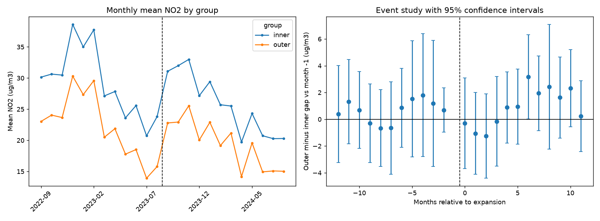

# Did the 2023 ULEZ expansion cut NO2 in outer London?

**Question:** on 29 August 2023 London's Ultra Low Emission Zone was extended to every borough. Did roadside and background nitrogen dioxide in outer London fall by more than it would have anyway?

**Answer:** not detectably. NO2 fell by about 12% in outer London in the year after the expansion, but it fell by the same amount in inner London, where the zone had applied since 2021. The difference-in-differences estimate is +0.4 µg/m³ with a 95% confidence interval of -2.4 to +3.2.

## Results

Monthly mean NO2 at 28 London Air Quality Network monitors, September 2022 to August 2024 (12 months each side of the expansion).

| Group | Sites | Year before | Year after | Change |
|---|---:|---:|---:|---:|
| Outer London (newly charged) | 10 | 22.1 µg/m³ | 19.4 µg/m³ | -2.8 |
| Inner London (charged since 2021) | 18 | 29.2 µg/m³ | 25.6 µg/m³ | -3.6 |

| Specification | Estimate | 95% confidence interval | p-value |
|---|---:|---:|---:|
| NO2 in µg/m³, all sites | +0.41 | -2.35 to +3.17 | 0.77 |
| Log NO2 (proportional change) | -0.1% | -8.6% to +8.5% | 0.99 |
| Roadside and kerbside sites only (19 sites) | -0.22 | -4.24 to +3.80 | 0.91 |

- **No effect is distinguishable from zero** in any specification.
- **The interval is informative, not just wide.** It rules out a fall of more than about 2.4 µg/m³ (roughly 11% of the outer London average) relative to inner London.
- **The parallel trends check passes.** In the year before the expansion the gap between the two groups drifted by 0.04 µg/m³ per month (p = 0.77).



## Why a null result is still worth reporting

A null here does not mean the policy did nothing. Three things could hide a real effect:

1. **The comparison group was already treated.** Inner London had its own ULEZ from October 2021. If its air was still improving because of that, the comparison understates the outer London effect.
2. **Spillover.** Vehicles replaced to comply in outer London also drive through inner London, which lowers NO2 in the comparison group too.
3. **Anticipation.** Drivers replaced non-compliant vehicles before the start date, so part of the effect falls in the "before" period.

All three push the estimate towards zero. A comparison against cities outside London would address the first two, and is the obvious next step.

## Method

- **Data:** hourly NO2 from the London Air Quality Network API (Imperial College London), averaged to site-months. A site-month needs at least 75% of its hourly readings, and a site needs at least 20 of the 24 months.
- **Treated and comparison groups:** assigned by borough. Outer boroughs lie wholly outside the North and South Circular roads (the 2021 boundary) and inner boroughs wholly inside. Boroughs that the boundary cuts through are excluded because a site's status there is ambiguous.
- **Model:** two-way fixed effects (site and month) with standard errors clustered by site, in statsmodels.
- **Checks:** an event study with month-by-month estimates, a pre-period trend test, a log specification and a roadside-only subset.

## Limitations

- **Small sample.** There are 10 treated sites across 6 boroughs, and cluster-robust standard errors are less reliable with this few clusters.
- **Borough-level assignment is an approximation** of the true zone boundary.
- **No weather adjustment.** Month fixed effects absorb London-wide weather, but not differences between inner and outer London.
- **NO2 only.** Particulates and traffic counts are not analysed.

## Run

```bash
pip install -r requirements.txt
```

```bash
python pipeline.py
```

```bash
python -m pytest
```

The first run makes about 1,000 small API requests and takes roughly 20 minutes. Results are cached per site, so an interrupted run resumes. All figures above come from `reports/results.json`.

## Data source

London Air Quality Network, Environmental Research Group, Imperial College London (londonair.org.uk). Raw data is not redistributed in this repository.
